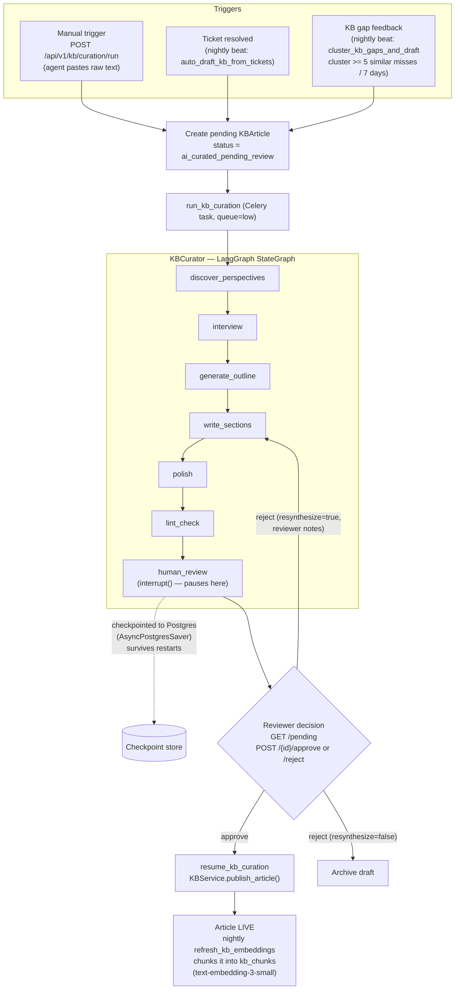
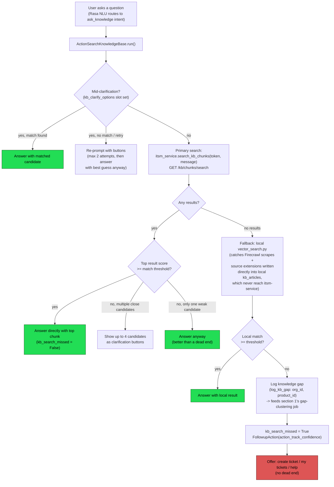
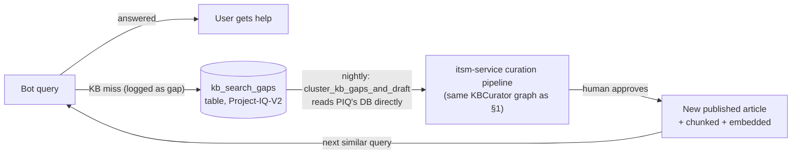

# KB Wiki Curation + Federated RAG — How It Works

Status: **implemented** (all 5 phases of `docs/plans/KB_WIKI_CURATION_RAG_PLAN.md` shipped 2026-08-18).
Spans two repos: **itsm-service** (curation/authoring) and **Project-IQ-V2** (bot query path).

This doc explains the current, real flow — not the original plan (several phases diverged
from the original plan once real code was checked; see `docs/plans/KB_WIKI_CURATION_RAG_PLAN.md`
§9 and the phase notes for what changed and why).

---

## 1. Content curation (itsm-service) — how an article gets written

Three independent triggers feed one shared synthesis pipeline. A human always reviews
before anything goes live.

**Notes on the triggers:**
- **Manual** — an agent has raw content (a doc, meeting notes) and wants it turned into a proper KB article.
- **Ticket resolved** — replaces the old single-LLM-call `KBDrafter` outright; every resolved ticket now goes through the same full STORM pipeline as everything else, one synthesis mechanism instead of two.
- **Gap feedback** — closes the loop with section 2 below. itsm-service reads Project-IQ-V2's Postgres **directly** (same cross-repo direct-DB-read pattern `kb_sync.py` already uses in the other direction) to find query clusters the bot couldn't answer, and turns a real, recurring gap into a draft article automatically.

---

## 2. Bot query path (Project-IQ-V2) — how a question gets answered

**Auth scoping on the primary search:**
- Logged-in user → their own IAM JWT is forwarded → itsm-service scopes results to that tenant's private + public content.
- Anonymous user (no token) → itsm-service scopes to **global public only** (`tenant_id IS NULL AND visibility = public`) — no special auth mechanism needed, this is just a query-scoping rule.

**Why two search paths instead of one:** itsm-service's chunked index (`kb_chunks`, heading-aware chunks + `text-embedding-3-small` embeddings) is the system of record and does real RAG-grade search — it's primary. The local `vector_search.py` index is a deliberate fallback, kept alive because Firecrawl scraping and source extensions (Google Sheets / Website / MS Teams via `extensions/_kb_adapter.py`) write content straight into Project-IQ-V2's own DB and never reach itsm-service — without the fallback, that content would be permanently unsearchable.

---

## 3. The full loop, end to end

A question the bot couldn't answer today becomes, after enough repeats, a candidate KB article
the bot *can* answer tomorrow — without anyone manually noticing the pattern.

---

## Where the code lives

| Concern | Repo | File(s) |
|---|---|---|
| Curation orchestration | itsm-service | `app/services/ai/kb_curator.py` |
| Curation triggers (Celery tasks + beat schedule) | itsm-service | `app/workers/tasks_kb.py`, `app/workers/celery_app.py` |
| Human review checkpoint store | itsm-service | `app/services/ai/kb_curation_checkpointer.py` |
| Curation review API | itsm-service | `app/api/v1/kb_curation.py` |
| Chunking + chunk search API | itsm-service | `app/services/ai/kb_chunker.py`, `app/api/v1/kb_chunk_search.py` |
| Gap clustering | itsm-service | `app/services/ai/kb_gap_clusterer.py` |
| Bot query action | Project-IQ-V2 | `action_server/actions/actions_kb.py` |
| Local fallback index | Project-IQ-V2 | `common/vector_search.py` |
| Gap logging | Project-IQ-V2 | `common/db/_kb_gaps.py` |
| Confidence/frustration signal unification | Project-IQ-V2 | `action_server/actions/actions_general.py` (`ActionTrackConfidence`) |

For the decision history and what changed vs. the original plan during implementation, see
`docs/plans/KB_WIKI_CURATION_RAG_PLAN.md`.
