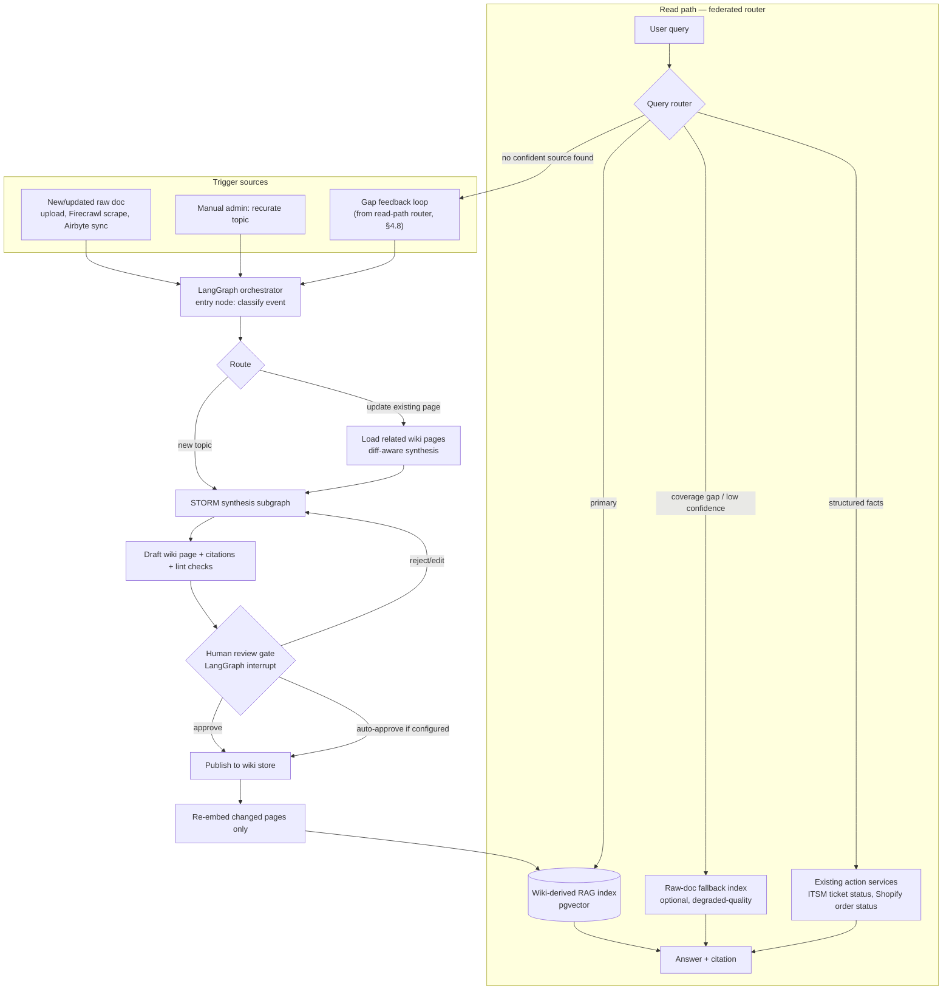

# Knowledge-Base Wiki Curation + Federated RAG — Strategy & Architecture Plan

Status: **planning only — no implementation**
Scope: covers `Project-IQ-V2` (this repo) and its relationship to `itsm-service` (separate repo, canonical KB system of record)

---

## 0. Executive Summary

The ask was: (1) an LLM-wiki curation layer sitting between raw documents and the RAG index — new docs get synthesized into a clean, maintained wiki before anything is indexed, not indexed directly; (2) LangGraph to orchestrate the event triggers (a doc changes → route it → curate it) with STORM methodology inside one node doing the actual deep-synthesis writing; (3) a "two-way" (federated / router-based) RAG system on the read side.

Before designing any of that, a full current-state audit was run (§1) because this codebase already has *two* KB systems and *three* retrieval implementations layered on top of each other — a redesign that ignored that would immediately conflict with what's already there. The single most important finding: **there is no existing curation/synthesis step anywhere today** (ingestion is either manual human authoring in `itsm-service`, or mechanical scrape-and-store via Firecrawl with zero LLM involvement) — so the wiki-curation layer is genuinely greenfield. But two things are **not** greenfield and must be treated as prerequisites, not side effects, of this build:

1. **Zero tenant isolation in KB retrieval today** (§1.5) — a real security/data-isolation gap, independent of this feature, that a new curation+indexing pipeline must not inherit or worsen.
2. **No background job infrastructure exists in this repo** (§1.7) — LangGraph's orchestration needs to run outside the request/response cycle, which means picking and standing up a task queue as part of this work, not assuming one exists.

This document treats the "where does curation actually live — this repo or `itsm-service`?" question as the single biggest open decision (§10) and writes the rest of the plan to work either way, flagging the divergence points explicitly.

---

## 1. Current-State Audit (grounds every design decision below)

Full detail lives in the research transcript this plan was built from; summarized here with file:line references so nothing below is designed against a guess.

### 1.1 Two KB systems wearing one name
- **`itsm-service`** (separate repo) is the real system of record: multi-tenant, versioned, human-authored. Schema (`docs/itsm-design/01-er-model.md:436-509`): `kb_spaces` (tenant_id, scope), `kb_categories` (tree), `kb_articles` (tenant_id, space_id, status draft/under_review/published/archived, visibility public/internal/agents_only, author_id, version, `search_vector TSVECTOR`, `embedding VECTOR(1536)` via `text-embedding-3-small`), plus `kb_article_versions`, `kb_tags`, `kb_article_feedback`, `kb_article_attachments`.
- **This repo's bot** mirrors only the `published` + `visibility='public'` slice (`common/kb_sync.py:37-49`) into a flat local `kb_articles` table — no `tenant_id`, no category tree, no tags, no versions — then **re-embeds locally with a different, smaller embedding model** (384-dim MiniLM) instead of reusing itsm's 1536-dim OpenAI embedding. Every sync is a full `DELETE` + reinsert (`common/kb_sync.py:71`).

### 1.2 Retrieval is implemented three separate ways, never reconciled
| Mechanism | Where | Embedding model | Chunking | Vector backend | Used when |
|---|---|---|---|---|---|
| Primary | `common/vector_search.py` | `paraphrase-multilingual-MiniLM-L12-v2` | fixed 150-word windows | pgvector (`ivfflat`) if available, else numpy brute-force | first, in `ActionSearchKnowledgeBase` |
| Fallback | `web/api/kb_cache_manager.py` (whole-article) | `all-MiniLM-L6-v2` | one embedding per article (title+question+keywords, **not body**) | numpy cosine (no ANN index) | if primary scores &lt; 0.35 |
| Fallback (config-disabled by default) | `kb_cache_manager.py` (section/QA cache) | same as above | heading-aware, 60-220 word chunks | numpy cosine | only if `section_search_enabled=True` |

No FAISS anywhere. The only real ANN index in the stack is Postgres `ivfflat` inside pgvector, and only when it's installed.

### 1.3 Confidence/escalation logic is three independent, uncoordinated thresholds
- NLU-intent confidence (Rasa `DIETClassifier` + `FallbackClassifier`, threshold 0.5) → `action_embedding_fallback` (own separate 0.62 cosine threshold against training examples).
- KB retrieval confidence: 0.35 (pgvector chunk) or 0.3 (hybrid whole-article `min_score_threshold`), decided inside `ActionSearchKnowledgeBase` (`action_server/actions/actions_kb.py`).
- Human-handoff escalation: `low_conf_streak >= 2` or `frustration_score >= 0.75`, tracked independently in `ActionConfirmHandoff` — **not driven by KB search failing**, driven by NLU confidence instead.

These three never talk to each other today. A federated/router RAG design (§4.7) is a natural place to unify them.

### 1.4 "KB health/gaps" is analytics only
`common/db/_kb_gaps.py`: logs `(query, app_id, sender_id)` to `kb_search_gaps` only when zero articles match at all; reporting is a flat `GROUP BY query` — literal string grouping, no clustering/dedup/embedding-based grouping of near-duplicate phrasings, no LLM summarization. A human reads the list and manually decides what to write. This is the natural hook point for the "two-way" write-back loop (§4.8) but currently does none of that work itself.

### 1.5 Zero tenant isolation in KB retrieval (pre-existing gap, not caused by this feature)
`search_articles(query, app_id=None)` accepts `app_id` but never uses it (dead parameter). No `kb_articles`, `kb_chunks`, or `kb_search_gaps` table has an `org_id`/`tenant_id` column, despite the rest of the codebase having a real, deliberate multi-tenant column pattern (`conversations`, `handoff_queue`, `canned_responses`, `shopify_connections` all have it — see `common/db/_connection.py:209-305`). **Today, if itsm-service ever hosts more than one tenant's public KB content, every tenant's bot can retrieve every other tenant's articles.** This must be fixed as part of (or strictly before) standing up a new indexing pipeline, or the new pipeline just industrializes the leak.

### 1.6 No existing curation/synthesis step
Ingestion today is either a human directly authoring the final article text in itsm-service, or Firecrawl/Airbyte mechanically scraping → regex-cleaning markdown → storing verbatim, with **no LLM call anywhere in that path**. This is good news for the plan: there's nothing to migrate away from, no existing synthesis logic to reconcile with.

### 1.7 No task queue / background job infrastructure
No Celery/RQ/APScheduler/cron anywhere in this repo (the P3 plan's `celery-beat` reference is `itsm-service`, a different repo). The only async patterns today are a one-shot daemon `threading.Thread` for KB cache warm-up and `eventlet.tpool.execute` to keep blocking calls off the eventlet hub — with a documented deadlock war-story (`kb_cache_manager.py:308-322`) from a prior attempt to use `asyncio.run_until_complete` here. **Any LangGraph-orchestrated pipeline needs a real job runner stood up from scratch, and it needs to be eventlet-compatible** (or run in a fully separate process/worker, sidestepping the eventlet hub entirely — recommended, see §4.10).

---

## 2. Goals, Translated Into Concrete Requirements

| User's ask | Concrete requirement |
|---|---|
| "Doc to wiki" / LLM-wiki pattern | New/changed source documents never get indexed directly. An LLM curation step reads the source **and relevant existing wiki pages**, then creates/updates/merges wiki pages (Markdown, one page per topic/policy/entity), before anything reaches the RAG index. |
| "Run the RAG pipeline based on this wiki" | The RAG index is built exclusively from curated wiki pages, not raw source documents. Raw documents remain as an audit trail / citation source, never a retrieval target on their own (except as an explicit fallback, see §4.7). |
| LangGraph for event triggers + routing raw data | A LangGraph `StateGraph` is the orchestrator: it receives ingestion events (new doc, doc updated, manual "recurate" request, gap-detected auto-trigger), classifies/routes them, and drives the multi-step curation workflow including a human-approval interrupt. |
| STORM inside one node for deep synthesis | One LangGraph node (a subgraph, in practice) runs a STORM-style pipeline: perspective discovery → multi-perspective question-asking against the source doc + existing wiki (via STORM's local-corpus `VectorRM` mode, **not** web search) → outline generation → section writing with citations back to the source → polish/dedup. |
| Two-way / federated / router-based RAG | The read path is a query router that can pull from more than one backend (curated-wiki index as primary, raw-doc fallback for coverage gaps, live structured data via existing action services) and — the "two-way" part — failed/low-confidence reads write back into the trigger queue as a synthetic "gap detected" event, closing the loop between read failures and curation. |

---

## 3. Conceptual Architecture



---

## 4. Component Design

### 4.1 Where curation lives — the framing decision

Two options, both viable, with real tradeoffs. This plan does **not** pick one — it's called out explicitly in §10 as the decision the user needs to make, because it changes which repo owns most of the new code.

**Option A — Curation lives in `Project-IQ-V2` (this repo), as a layer between `kb_sync` and the bot's retrieval:**
- Pro: doesn't touch `itsm-service` at all; can ship independently; fits this repo's existing pattern of "mirror + locally re-process" (it already re-embeds locally with a different model).
- Con: itsm-service remains the authoring system of record for *raw* articles, so this repo would be curating a copy of a copy — the curated wiki becomes a third representation of the same knowledge, and itsm-service's human authors have no visibility into what the wiki curation changed or why.
- Con: doesn't fix the tenant-isolation gap (§1.5) by itself — the wiki layer would need its own `org_id` plumbing added independently of itsm's tenant model.

**Option B — Curation extends `itsm-service`'s authoring workflow directly:**
- Pro: itsm already has `status` (draft/under_review/published), `version`, `author_id`, `last_edited_by` — a curated wiki page is naturally just a `kb_article` with a new `status` value (e.g. `ai_curated_pending_review`) and a `curation_source` lineage field pointing at the raw doc. Tenant isolation is inherited for free (itsm's `kb_articles.tenant_id` already exists).
- Con: requires changes in a separate repo/service, a bigger coordination cost, and this repo's bot would need to keep syncing published articles as it does today (no change to the mirror-and-re-embed pattern, which stays as-is).

**Recommendation if forced to choose**: Option B is architecturally cleaner (one system of record, tenant isolation inherited, human review workflow already has the right state machine) but Option A is faster to ship and fully within this session's normal working scope. The rest of this document is written so either choice only changes *where* §4.2-§4.5 physically live — the graph design, STORM node, and wiki data model are the same either way.

### 4.2 LangGraph orchestrator — node design

A single `StateGraph` per curation run, with this shape:

```
entry_classify_event
    → route_new_vs_update (conditional edge)
        → load_related_wiki_pages   (update path only — reads existing pages via the router, §4.7, scoped to the topic)
    → storm_synthesis_subgraph      (§4.3 — the "deep synthesis" node the user asked for)
    → lint_check                     (contradiction/staleness/orphan checks, §4.5)
    → human_review_interrupt         (LangGraph interrupt() — pauses, persists state via checkpointer)
        → [approve] → publish_to_wiki_store
        → [reject/edit] → back to storm_synthesis_subgraph with reviewer notes injected into state
    → publish_to_wiki_store
    → trigger_reindex                (re-embeds only the pages that actually changed)
```

**State object** (the thing that flows through every node) should carry at minimum: `event_type` (new_doc | doc_updated | manual_recurate | gap_feedback), `source_doc` (raw content + metadata: tenant_id, uploaded_by, timestamp), `related_wiki_page_ids` (populated by the update-path loader), `draft_pages` (list of {page_id, title, markdown, citations}), `lint_findings`, `review_decision`, `reviewer_notes`. Because LangGraph checkpoints state at every node boundary, the human-review pause can survive a process restart — important since review may take hours/days, not seconds.

**Why a checkpointer matters here specifically**: `interrupt()` requires a checkpointer to persist state across the pause (§ research, LangGraph human-in-the-loop docs). Given this repo already talks to Postgres, a Postgres-backed LangGraph checkpointer (`langgraph-checkpoint-postgres`) is the natural fit — no new datastore needed.

### 4.3 STORM synthesis subgraph — the "deep synthesis" node

This is a subgraph (itself composed of nodes), matching the official reference pattern of building STORM as a LangGraph pipeline (confirmed to be a documented, existing pattern — see §11 references — not a novel/untested combination):

1. **Perspective discovery**: instead of STORM's default "survey similar Wikipedia articles" step, generate perspectives from (a) the existing wiki's category/index structure if updating a known topic, (b) a small fixed set of support-domain personas otherwise (e.g., "a customer who's never used this feature," "an agent troubleshooting an edge case," "someone checking a policy/compliance detail"). This keeps perspective generation grounded in the support-KB domain rather than open-ended.
2. **Multi-perspective question-asking**: each persona "interviews" an expert-agent that can only answer using the source document (+ related wiki pages) via STORM's `VectorRM` local-corpus retrieval mode — **not web search**, since the source of truth here is the org's own uploaded document, not the internet. This is the step that surfaces gaps/ambiguities the raw document doesn't directly answer.
3. **Outline generation**: hierarchical structure for the wiki page(s), informed by the Q&A transcript from step 2.
4. **Section writing with citation grounding**: each section is written with an explicit citation back to the specific passage in the source document it came from — critical for the human reviewer (§4.4) and for later contradiction/staleness lint (§4.5).
5. **Polish/dedup pass**: STORM's optional final stage — summarize, remove redundancy, ensure consistent terminology with the rest of the wiki.

**Cost/latency note**: STORM makes multiple LLM calls per topic (one per persona per question-round, plus outline + writing + polish calls) — this is not a single-prompt operation. Budget for this explicitly in the phased rollout (§7) rather than assuming it's cheap; a first version should probably cap perspectives to 2-3 and question rounds to 2-3 to keep latency/cost bounded, expanding only if quality requires it.

### 4.4 Wiki storage & versioning

Recommendation: **DB-backed, not a raw Markdown folder** (departing from Karpathy's literal folder-of-files pattern), because:
- This is a multi-tenant product, not a personal knowledge base — file-based storage has no natural tenant boundary, concurrent-write story, or access-control layer, all of which a DB table gets for free.
- If Option B (§4.1) is chosen, this is just new columns/status-values on itsm's existing `kb_articles` + `kb_article_versions` — no new storage system at all.
- If Option A is chosen, a new table (e.g. `kb_wiki_pages`) should still deliberately mirror itsm's version/status/author columns rather than reinventing them, specifically so migrating to Option B later is a schema-mapping exercise, not a rewrite.

Karpathy's `index.md` (catalog) and `log.md` (append-only change log) concepts should be **generated views over the DB**, not physical files — e.g. an admin-UI page listing pages by category with one-line summaries (index) and a `kb_wiki_change_log` table (append-only, one row per publish event, referencing the source event that triggered it) rather than a literal markdown file. This keeps the "one source might touch 10-15 pages" cross-referencing behavior (a real STORM/wiki-pattern characteristic) queryable rather than requiring a full-repo grep.

### 4.5 Lint pass — contradiction & staleness checks

Borrowing directly from the Karpathy pattern's "lint" concept, run automatically before the human-review gate (§4.2), not as a separate manual step:
- **Staleness/contradiction check**: does the new source explicitly supersede a claim in an existing wiki page (e.g., "we no longer support X")? Flag for reviewer attention rather than silently overwrite — citation grounding (§4.3 step 4) makes this checkable by comparing source dates.
- **Orphan check**: does the new/updated page have at least one inbound reference from the category index, or is it unreachable?
- **Coverage cross-check against `kb_search_gaps`** (§1.4): if this curation run was triggered by a gap-feedback event (§4.8), verify the new page's content actually would have answered the logged gap query — closes the loop with a concrete check rather than assuming the synthesis worked.

### 4.6 RAG re-indexing — consolidating three mechanisms into one

The current-state audit (§1.2) found three independent, never-reconciled retrieval implementations. This plan's position: **the wiki-curation project is the right moment to consolidate them**, since every existing implementation was built against raw articles that this plan replaces as the retrieval unit anyway.

Recommended single pipeline (retiring the other two, phased — see §7):
- **Retrieval unit**: curated wiki pages, chunked heading-aware (the existing `kb_cache_manager` section-chunker logic, 60-220 words, is the better of the two existing chunkers — reuse its algorithm rather than `vector_search.py`'s fixed 150-word window).
- **Embedding model**: pick one and standardize — either keep pgvector + a single MiniLM variant (cheap, already proven in this repo), or take the opportunity to align with itsm-service's `text-embedding-3-small` (1536-dim) if Option B (§4.1) is chosen, so the whole system shares one embedding space instead of three.
- **Vector backend**: pgvector stays the standing decision (already proven, already has the `ivfflat` index pattern and the "which model built this index" staleness guard in `vector_search.py` — reuse that guard mechanism for the new wiki-chunks table too).
- **Only re-embed changed pages** on publish (§4.2's `trigger_reindex` node), not a full rebuild — a meaningful improvement over today's full delete-and-reinsert `kb_sync` pattern.

### 4.7 Federated / router-based RAG — the read path

This is the concrete design for "two-way RAG": a query router (a lightweight classifier — could be as simple as a few-shot prompt, or reuse the existing `action_embedding_fallback`'s nearest-intent infrastructure) decides, per query, which backend(s) to consult:

1. **Primary**: curated-wiki RAG index (§4.6). This should handle the large majority of queries once curation has run for a topic area.
2. **Raw-doc fallback** (optional, and should probably ship *disabled* initially): if the wiki has no coverage yet for a topic, fall back to searching raw/uncurated source documents directly — explicitly lower-confidence, and any answer surfaced this way should be visibly flagged to the user as "not yet reviewed" or similar, since it bypasses the whole curation/citation/review pipeline this plan exists to build.
3. **Structured/live-data sources**: not RAG at all, but the router should also recognize when a query is really asking for live data the existing action services already own (order status → `shopify_service`, ticket status → `itsm_service`) rather than static knowledge — this is really just formalizing what Rasa's NLU intent routing already does today (§1.3), not new capability, but worth explicitly modeling as one of the router's branches so the whole read path is describable as one system instead of "NLU does some routing, then KB does separate routing."
4. **This unifies the three uncoordinated confidence thresholds found in §1.3** into one place: a single router makes the KB-vs-escalate decision, instead of NLU-confidence, KB-score-confidence, and handoff-frustration-score being three independent signals that don't talk to each other today.

### 4.8 The "two-way" closed loop — gap feedback back into curation

This is the piece that makes it federated/two-way rather than a one-directional read path: when the router (§4.7) can't find a confident answer anywhere, that's exactly today's `log_kb_gap()` call (§1.4) — except today nothing happens with that log beyond a human reading a list. This plan's addition: an automated (but rate-limited and human-gated) job that:
1. Periodically clusters recent `kb_search_gaps` entries by embedding similarity (closing the "no clustering/dedup" gap noted in §1.4) rather than literal string grouping.
2. For clusters above a volume threshold (e.g., "this same underlying question has been asked 5+ times in 7 days with no answer"), emits a synthetic `gap_feedback` event into the LangGraph orchestrator (§4.2) — *not* auto-publishing a new page, but auto-*drafting* one for human review, same as any other trigger.
3. This is the actual "two-way" mechanic: read-path failures become write-path inputs, closing the loop the current codebase has never had (today gap data is purely descriptive analytics, per §1.4).

### 4.9 Multi-tenancy — must-fix, framed as a prerequisite not a nice-to-have

Independent of which option is chosen in §4.1, the new wiki/index tables must carry `tenant_id`/`org_id` from day one, and retrieval must filter by it — not repeat the existing dead-parameter mistake (`search_articles(query, app_id=None)` that's never used, §1.5). Recommend treating this as **Phase 0** (§7) regardless of the rest of the timeline, since it's a real security gap today independent of this feature, and it's far cheaper to build the new tables tenant-scoped from the start than retrofit later.

### 4.10 Task queue / infra choice

**Corrected 2026-08-13**: §1.7's "no task queue exists" finding is scoped correctly to Project-IQ-V2 but was applied too broadly when §9.2's decision was made. Since curation lives in itsm-service (§4.1 Option B, decided), the relevant repo's task-queue state is: **itsm-service already has one, fully operational.**

- `docker-compose.yml` runs `worker` and `worker-beat` services alongside `api`/`db`/`redis`, all treated as first-class prod services (`docker-compose.prod.yml` adds `restart: unless-stopped` to all of them).
- `app/workers/celery_app.py` defines the broker/backend (Redis DBs 1/2), `high`/`low`/`default` queues, and an established `task_routes` + `beat_schedule` convention already covering SLA, IAM sync, AI budget flush, webhook retries, alert escalation, SLO burn evaluation, and more.
- `app/redis_client.py` is a shared async Redis pool already used well beyond Celery (rate limiting, caching) — Redis is load-bearing infra here, not something being introduced.
- LangGraph's orchestration (multi-minute-to-multi-hour runs, given the human-review pause) should run as **Celery tasks on this existing broker** — no new queue technology, no RQ/Arq, no spike needed. The `interrupt()` pause is handled by LangGraph's own Postgres checkpointer (§4.2), which is a separate concern from the task queue that kicks off/resumes graph runs.
- Project-IQ-V2's own "should be a background job but isn't" code paths (manual KB-cache-refresh trigger, Firecrawl's synchronous crawl-polling loop, §1.7) remain a real gap in *that* repo, but are unrelated to the itsm-service-hosted curation pipeline and out of scope for this project unless Project-IQ-V2 itself later needs async jobs for something else.

**Existing itsm-service KB automation, discovered during this correction** (relevant context for Phase 2 scoping, not resolved here — see §9.5-adjacent note below): `app/workers/tasks_kb.py` already runs two KB-related beat jobs — `refresh_kb_embeddings` (nightly, whole-article embedding refresh via `EmbedderService`, `text-embedding-3-small`, no chunking) and `auto_draft_kb_from_tickets` (nightly, drafts a `KBArticle(status=draft)` from each newly-resolved ticket via `KBDrafter.draft_from_ticket` — a single LLM call, no LangGraph/STORM/multi-perspective synthesis, linked via `TicketKBLink`). This is a much thinner, pre-existing "curation" mechanism, triggered by ticket resolution rather than document upload — decided (2026-08-13) to leave it noted rather than fold in or replace now; revisit when Phase 2 (event orchestration) is actually scoped.

---

## 5. Human-in-the-Loop Review Workflow

- Every curation run pauses at `human_review_interrupt` (§4.2) before publish — no auto-publish path in the initial build, even though LangGraph supports configuring auto-approval later once trust in the pipeline is established.
- Reviewer sees: the draft wiki page(s), the source document, per-section citations (§4.3 step 4), and lint findings (§4.5) — enough to approve, request changes (which re-enters the STORM subgraph with reviewer notes appended to state), or reject outright.
- This should reuse/extend the existing admin UI's `KnowledgeBasePage.jsx` (§1.1 — currently read-only monitoring) as the natural home for a new "Pending Wiki Drafts" view, rather than building a separate admin surface.

## 6. New Dependencies This Would Introduce

| Dependency | Purpose | Notes |
|---|---|---|
| `langgraph` (+ `langgraph-checkpoint-postgres`) | Orchestration graph + durable human-review pause | New to this repo; Python-native, fits the existing Flask/Python stack |
| STORM (`stanford-oval/storm` package, or a hand-rolled equivalent of its pipeline) | Deep-synthesis node | Can run its `VectorRM` local-corpus mode — no web-search dependency needed for this use case |
| Task queue (Celery, or RQ/Arq) | Background execution of the LangGraph run | First task-queue infra in this repo (§4.10) — real operational addition (broker, worker deployment), not just a pip install |
| Embedding model (decision, not new necessarily) | Wiki-chunk embeddings | Either reuse existing pgvector+MiniLM setup, or align with itsm's `text-embedding-3-small` if Option B is chosen (§4.1) |

## 7. Phased Roadmap

| Phase | Scope | Depends on |
|---|---|---|
| **0 — Prerequisite hardening** | Fix tenant-isolation gap (§4.9) on whichever KB tables retrieval will use; stand up the chosen task queue (§4.10); pick Option A vs B (§4.1) | Nothing — should happen regardless of the rest |
| **1 — Wiki data model + manual curation** | Build the wiki storage layer (§4.4) and a manual "curate this doc" admin action that runs the STORM subgraph (§4.3) once, synchronously-ish, with human review (§5) — no event-driven triggers yet | Phase 0 |
| **2 — LangGraph event orchestration** | Wire real triggers (new doc uploaded, doc updated) into the LangGraph graph (§4.2) running as a background job; still human-review-gated | Phase 1 |
| **3 — Consolidated RAG re-indexing** | Retire the three duplicate retrieval mechanisms (§1.2) in favor of the single wiki-chunk pipeline (§4.6); migrate existing bot retrieval calls to the new index | Phase 1 (can run parallel to Phase 2) |
| **4 — Federated router** | Build the query router (§4.7) unifying KB-vs-live-data-vs-escalate decisions; retire the three uncoordinated confidence thresholds (§1.3) into this one place | Phase 3 |
| **5 — Closed-loop gap feedback** | Gap clustering + auto-draft-trigger (§4.8) — the "two-way" mechanic fully wired | Phase 4 |

Each phase should ship independently reviewable and independently valuable — Phase 1 alone (manual curation assist) already directly improves KB quality even with nothing else built yet.

## 8. Risks & Open Questions

- **Cost/latency of STORM's multi-call synthesis** (§4.3) needs a real budget decision before Phase 1 — this is not a single-prompt operation, and running it on every doc-update event (rather than batched/rate-limited) could get expensive at scale.
- **Where curation lives (§4.1, Option A vs B) is the single biggest open decision** — it determines which repo most of this work happens in, and whether tenant isolation is inherited or must be built new.
- **Embedding-model consolidation (§4.6) breaks the existing pgvector index** if changed — any model swap requires the full re-embed `vector_search.py` already guards for (`_persisted_pg_model` staleness check), so this is a known, already-solved problem, just needs to be triggered deliberately once.
- **Eventlet/worker compatibility** (§4.10, §1.7) — this repo has a specific, documented history of deadlocks from blocking calls inside the eventlet hub; the task-queue choice must avoid repeating that class of bug, ideally by running fully outside the web process rather than patching around it again.
- **Raw-doc fallback (§4.7 point 2) risks undermining the whole point of curation** if it's too readily used — recommend shipping it disabled initially and only enabling per-tenant once coverage gaps are actually observed and painful.

## 9. Decisions Needed From You

**Decided 2026-08-13** (all four, recommended option in each case):

1. **Option A vs Option B for where curation lives** (§4.1) → **Option B — extend `itsm-service`.** Curated wiki page = a `kb_article` with a new status (`ai_curated_pending_review`) + `curation_source` lineage field. Tenant isolation inherited from itsm's existing `tenant_id`. Most of the new schema/workflow code for §4.2-§4.5 now lands in the `itsm-service` repo, not this one.
2. **Task queue choice** (§4.10) → **Corrected 2026-08-13**: this decision was made without checking itsm-service's actual state. `itsm-service` already runs a full, production `worker`/`worker-beat` Celery + Redis stack (`docker-compose.yml`, `app/workers/celery_app.py`, task-routing + beat-schedule conventions already established, including existing KB-specific jobs — see the KBDrafter note below). Since Option B put curation in itsm-service, there is no task-queue infra to stand up: the LangGraph orchestrator runs as Celery tasks on the existing broker, not a new RQ/Arq stack. The original "RQ or Arq, lighter footprint" reasoning only ever applied to Project-IQ-V2 (the genuinely greenfield repo per §1.7) and doesn't transfer to itsm-service.
3. **Embedding-model consolidation** (§4.6) → **Align with itsm's `text-embedding-3-small` (1536-dim)**, replacing this repo's local MiniLM re-embed. Consistent with Option B: one embedding space, itsm becomes the sole place embeddings are generated.
4. **Retiring the three existing retrieval mechanisms** (§1.2/Phase 3) → **In scope.** `vector_search.py`, `kb_cache_manager` whole-article, and `kb_cache_manager` section/QA cache all get retired in favor of the single wiki-chunk pipeline as part of this project, not deferred to separate cleanup.

**Net effect on §7 phased roadmap**: Phase 0 (tenant isolation + task queue) and Phase 1 (wiki data model) now primarily happen in `itsm-service`; this repo's role shifts toward Phase 3 (retiring its three local retrieval mechanisms and pointing the bot's read path at itsm's new wiki index instead of the local `kb_articles` mirror) and Phase 4 (federated router). This is a bigger architectural shift for this repo's `kb_sync.py`/`vector_search.py`/`kb_cache_manager.py` than Option A would have been — the mirror-and-locally-reindex pattern goes away entirely once the wiki index lives in itsm-service and this repo's bot queries it directly (or via a thin proxy) instead of maintaining its own copy.

**§9.5 (added 2026-08-13) — Where does the federated query router (§4.7) itself run?** → **In itsm-service**, alongside the wiki index it's routing over. `itsm-service` owns the primary-wiki-search / raw-doc-fallback / "this is really a structured-data query" branching and exposes one endpoint; this repo's `ActionSearchKnowledgeBase` (`action_server/actions/actions_kb.py`) becomes a thin client that calls that endpoint and, on a "structured data" signal back, dispatches to the Shopify/ITSM action services it already owns today. Rationale: keeps routing logic co-located with the data (and the tenant_id scoping) it's routing over, consistent with Option B's centralization of KB ownership in itsm-service — the router doesn't have to reach back across repos to decide whether wiki content exists for a topic.

**Concrete replacement for `vector_search.py`**: not a like-for-like file in this repo. The chunked-wiki-search logic (heading-aware chunker from `kb_cache_manager`, `text-embedding-3-small` embeddings, pgvector `ivfflat`, the `_persisted_pg_model` staleness guard) gets re-hosted as a new table + search endpoint in `itsm-service`. `ActionSearchKnowledgeBase` stops importing `vector_search.py` locally and instead calls that endpoint as the federated router's client. `common/kb_sync.py`'s full mirror-and-reembed job is retired entirely — there's no more local `kb_articles` shadow copy to keep in sync.

## 10. References

- [STORM (Stanford OVAL) — GitHub](https://github.com/stanford-oval/storm) — pipeline stages, `VectorRM` local-corpus mode, Co-STORM collaborative variant
- [Building STORM with LangGraph — official reference tutorial](https://github.com/langchain-ai/langgraph/discussions/527) — confirms this exact combination is a documented, existing pattern
- [LangGraph human-in-the-loop / `interrupt()` docs](https://docs.langchain.com/oss/python/langgraph/interrupts) — checkpointing and pause/resume semantics used in §4.2
- [Andrej Karpathy's LLM Wiki pattern — original gist](https://gist.github.com/karpathy/442a6bf555914893e9891c11519de94f) — folder structure, update algorithm, lint concept adapted in §4.4/§4.5
- [Efficient Federated Search for RAG using Lightweight Routing (arXiv 2502.19280)](https://arxiv.org/html/2502.19280v2) — router/federated RAG architecture grounding for §4.7
- [Learning to Route: Rule-Driven Agent Framework for Hybrid-Source RAG (arXiv 2510.02388)](https://arxiv.org/pdf/2510.02388)
